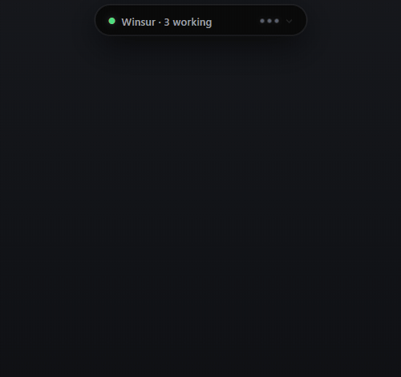
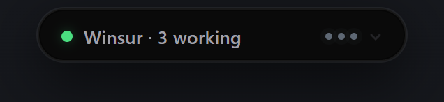
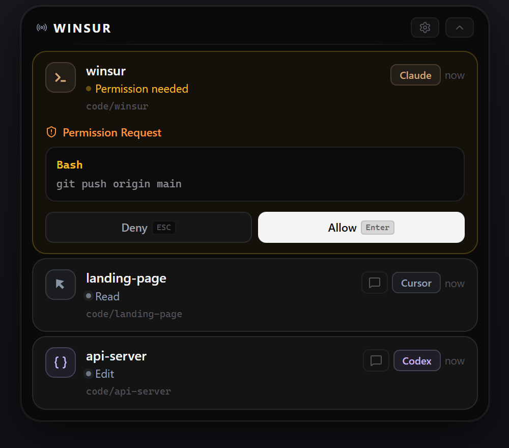
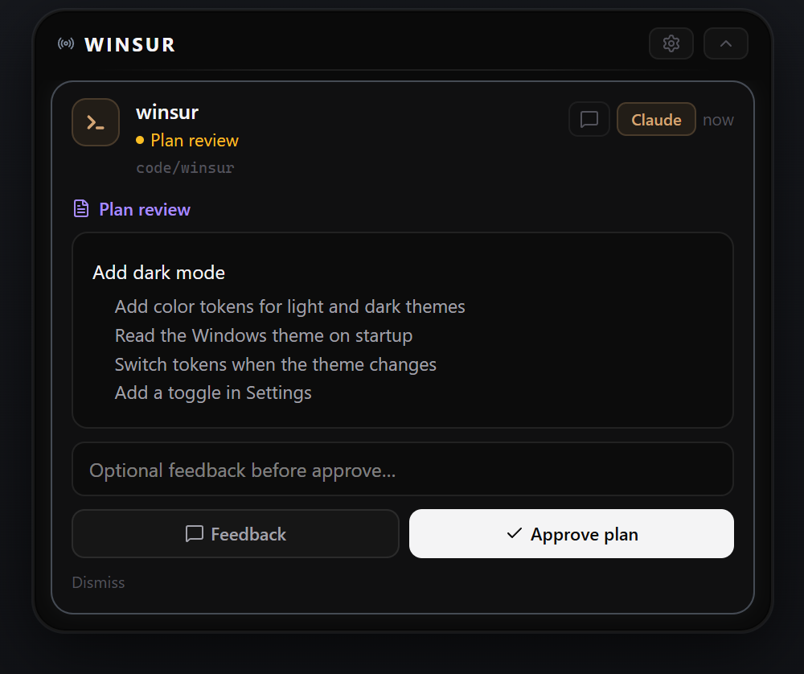
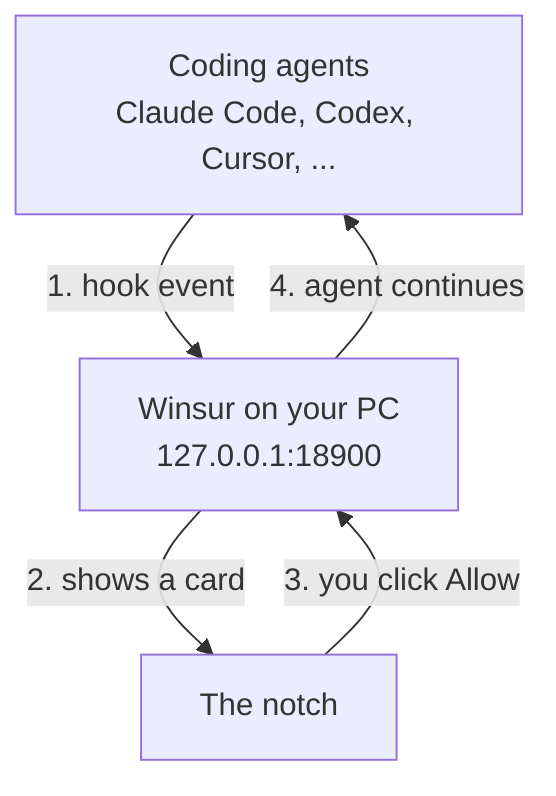

<div align="center">


# Winsur

### Your coding agents are waiting for you. Now you'll know.

A notch at the top of your Windows screen that shows what every AI coding agent is doing,<br>
and lets you approve their commands without leaving what you're working on.

<br>



<br>
<br>

<a href="https://github.com/suriya-z/winsur/releases/latest/download/Winsur-Setup.exe"></a>

Free and open source &nbsp;·&nbsp; Windows 10 and 11 &nbsp;·&nbsp; No account &nbsp;·&nbsp; Nothing leaves your PC

[](https://github.com/suriya-z/winsur/releases/latest)
[](https://github.com/suriya-z/winsur/releases)
[](https://github.com/suriya-z/winsur/stargazers)
[](LICENSE)

</div>

---

## You know this feeling

You start Claude Code on a refactor, Codex on the API tests, and Cursor on the landing page.
You switch to something else.

Twenty minutes later you check back. Claude has been sitting on
**"Allow `git push origin main`?"** for nineteen of them. Codex finished ages ago.
Cursor asked you a question nobody answered.

Your agents were fast. Waiting for you was the slow part.

**Winsur puts all of them in one place you can always see**, and taps you on the shoulder
the moment one of them needs you.

## What you get

<div align="center">

<br><sub>Collapsed, it's one line: how many agents are working, and a dot for each.</sub>
</div>
<br>

<table>
<tr>
<td width="50%" valign="top">

<h3>Approve commands from anywhere</h3>
When Claude Code wants to run a shell command or edit a file, the notch opens and shows
you the exact command. Press <kbd>Enter</kbd> to allow, <kbd>Esc</kbd> to deny.
No hunting for the right terminal.
</td>
<td width="50%" valign="top">

<h3>Review plans before work starts</h3>
When an agent proposes a plan, read it in the notch, then approve it or send feedback.
Winsur types your answer into the agent's terminal for you.
</td>
</tr>
</table>

And the small things that add up:

- **Sound and a Windows notification** when an agent needs you or finishes.
- **Click any agent to jump to its terminal** window.
- **Answer an agent's question** from the notch.
- **Drag the notch anywhere.** Clicks pass through the empty space around it.
- **Remote agents too:** watch agents on another machine over an SSH tunnel.

## Install in one step

<a href="https://github.com/suriya-z/winsur/releases/latest/download/Winsur-Setup.exe"><b>Download Winsur-Setup.exe</b></a> and open it. That's it.

- It installs for your user account in seconds. No admin rights, no wizard.
- It finds the coding agents on your PC and connects to them automatically.
- Restart any agent that was already running so it picks up the connection.

> [!NOTE]
> Winsur isn't code-signed yet, so Windows shows **"Windows protected your PC"** the first time.
> Click **More info**, then **Run anyway**. Signing certificates cost money; this project is free.

To uninstall: **Settings > Apps > Installed apps > Winsur > Uninstall**.

## Works with the agents you already use

| Agent | Live status and alerts | Approve commands from Winsur |
|---|:---:|:---:|
| **Claude Code** | Yes | Yes |
| **Codex CLI** | Yes | Not yet |
| **Cursor** | Yes | Not yet |
| **Grok Build** | Yes | Not yet |
| **OpenCode** | Yes | Not yet |
| **Antigravity** | Yes | Not yet |
| **Hermes** | Yes | Not yet |
| Gemini CLI, Windsurf, Qwen Code, Kimi, GitHub Copilot, Amp, Kiro and 10+ more | Best effort | Not yet |

Approving from Winsur means holding the agent's command until you answer, which needs
each agent's exact hook format. It's confirmed for Claude Code so far. Want your agent
added? [Open an issue](https://github.com/suriya-z/winsur/issues/new) with a link to its
hook docs.

## How it works



Modern coding agents can call a script or send a request at key moments: before running
a tool, when they need input, when they finish. These are called **hooks**. Winsur adds
its hooks to each agent's settings and listens for them on your own machine.

There's no cloud service in between. If Winsur isn't running, your agents keep working
and use their own permission prompts, as they did before.

## Your machine, your data

Winsur is a local app with no servers of its own. Here is everything it does outside
its own window:

| What | Details |
|---|---|
| Adds hooks to your agents' settings | For example `~/.claude/settings.json`. Your own hooks and settings are kept. A settings file that isn't plain JSON is left untouched. |
| Listens on `127.0.0.1:18900` | Reachable only from your PC. JSON requests only, and the `Host` header is checked, so websites can't send it fake events. |
| Focuses windows and types replies | Only when you click an agent or answer it, and only into the window it matched to that agent. |
| Opens links in your browser | Links in agent plans never load inside Winsur. |
| Stores settings | In `%USERPROFILE%\.winsur\` |
| Sends data anywhere | Never. No telemetry, no accounts, no update checks. |

## FAQ

<details>
<summary><b>Does it slow my agents down?</b></summary>
<br>
Barely. For Claude Code, each hook is a request to your own PC that takes a few
milliseconds. Agents that call the PowerShell hook script add a fraction of a second per
event. The only real wait is when an agent asked for permission and is waiting for you.
</details>

<details>
<summary><b>What happens if I don't answer a permission request?</b></summary>
<br>
After 5 minutes the request is denied, so nothing runs without you. If you cancel the
agent yourself, the request disappears from the notch.
</details>

<details>
<summary><b>What if Winsur is closed or crashes?</b></summary>
<br>
Your agents keep working and fall back to their own permission prompts in the terminal.
</details>

<details>
<summary><b>Mac or Linux?</b></summary>
<br>
Not yet. Window focus and the installer are built on Windows APIs, so Winsur is
Windows-only for now.
</details>

<details>
<summary><b>Is it really free?</b></summary>
<br>
Yes. MIT license, no paid tier, no account.
</details>

## Build from source

Requires Node.js 22 or newer.

```powershell
git clone https://github.com/suriya-z/winsur.git
cd winsur
npm install
npm start
```

| Command | What it does |
|---|---|
| `npm start` | Run in development mode with live reload |
| `npm test` | Unit, fault and regression tests |
| `npm run test:e2e` | Drive the real app window with Playwright |
| `npm run lint` | Check code style |
| `npm run dist` | Build `release\Winsur-Setup.exe` |

<details>
<summary><b>Project layout</b></summary>
<br>

| Path | Contents |
|---|---|
| `electron/` | Hook server, agent sessions, hook installer, window focus |
| `src/` | The notch and its panels (React) |
| `hooks/` | PowerShell script that command-based agents call |
| `test/` | Unit, end-to-end and fault tests |
| `scripts/readme-shots.cjs` | Regenerates the screenshots in this README from the real app |

</details>

<details>
<summary><b>Releasing</b></summary>
<br>

Bump `version` in `package.json`, then push a matching tag:

```powershell
git tag v0.1.4
git push origin v0.1.4
```

GitHub Actions runs the tests, builds `Winsur-Setup.exe` and publishes the release.
The download link at the top always points to the newest one.

</details>

## Contributing

Bug reports, agent requests and pull requests are welcome. Before opening a pull request:

```powershell
npm test
npm run lint
npx tsc -b
```

---

<div align="center">

**If Winsur saved you a trip to the wrong terminal, a star helps other people find it.**

<a href="https://star-history.com/#suriya-z/winsur&Date">
  
</a>

<br>

[MIT License](LICENSE) &nbsp;·&nbsp; Built by [Suriya](https://github.com/suriya-z)

</div>
