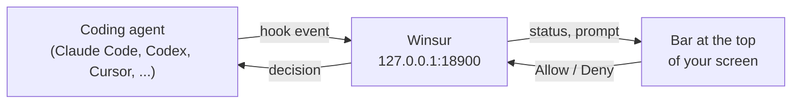

<div align="center">


# Winsur

**A small status bar at the top of your screen for the AI coding agents running on your PC.**
See what each agent is doing, approve its commands, and jump to its terminal without hunting through windows.

[](https://github.com/suriya-z/winsur/releases/latest)
[](#requirements)
[](LICENSE)

### [Download Winsur for Windows](https://github.com/suriya-z/winsur/releases/latest/download/Winsur-Setup.exe)

One file, about a minute to set up. Windows 10 or 11, 64-bit.

</div>

---

## Why Winsur

When you run Claude Code, Codex or Cursor in the background, you only find out an
agent stopped to ask a question when you go back and look. Winsur watches every
agent for you and shows one line at the top of the screen:

- **Which agents are working, waiting or done**, one dot per agent.
- **What an agent wants to run**, with Allow and Deny buttons, before it runs.
- **Questions and plans**, which you can answer from the bar.
- **A sound and a Windows notification** when an agent needs you.

Click an agent to bring its terminal window to the front.

## Install

1. [Download `Winsur-Setup.exe`](https://github.com/suriya-z/winsur/releases/latest/download/Winsur-Setup.exe).
2. Open it. Windows may say **"Windows protected your PC"** because the installer is
   not code-signed yet. Click **More info**, then **Run anyway**.
3. Winsur installs for your user account (no admin rights needed), starts, and
   appears at the top of the screen.

On first start, Winsur finds the agents installed on your PC and connects to them.
Restart any agent that was already running so it picks up the connection.

To remove Winsur, use **Settings > Apps > Installed apps > Winsur > Uninstall**.

## How it works



Most coding agents can run a small script or send a web request at key moments:
before a tool runs, when they need input, when they finish. Winsur adds itself to
those **hooks** and listens on your own machine. Nothing goes over the internet.

## Approving commands

For Claude Code, Winsur holds `Bash`, `Write`, `Edit` and `NotebookEdit` until you
answer:

| Action | Mouse | Keyboard |
|--------|-------|----------|
| Allow the oldest waiting request | **Allow** | `Enter` |
| Deny it | **Deny** | `Esc` |

The keyboard shortcuts work while the Winsur bar has focus. If you don't answer
within 5 minutes, the request is denied. If you cancel the
agent first, the request disappears from the bar.

Other agents show their activity, questions and plans, but keep their own approval
prompts. Holding a request requires knowing exactly how each agent reads the answer,
and that is only confirmed for Claude Code so far.

## Supported agents

Winsur connects to an agent when it finds its settings folder or program on your PC.

| Agent | Status and notifications | Approve from Winsur |
|-------|:---:|:---:|
| Claude Code | Yes | Yes |
| Codex CLI | Yes | No |
| Cursor | Yes | No |
| Grok Build | Yes | No |
| OpenCode | Yes | No |
| Antigravity | Yes | No |
| Hermes | Yes | No |
| Gemini CLI, Windsurf, Qwen Code, Kimi Code, GitHub Copilot, Amp, Kiro and others | Best effort | No |

The full list, with the config file each one uses, is in
[`electron/agents-registry.cjs`](electron/agents-registry.cjs).

## Privacy and security

Winsur runs entirely on your PC. Here is everything it does outside its own window:

- **Edits your agents' settings files** to add its hooks, for example
  `~/.claude/settings.json`. Your own hooks and settings stay as they are. If a
  settings file contains comments or anything else that isn't plain JSON, Winsur
  leaves that file alone and skips that agent.
- **Runs a local server on `127.0.0.1:18900`** to receive hook events. Only
  programs on your PC can reach it. It accepts JSON requests only and checks the
  `Host` header, so a website you visit cannot send it fake events.
- **Focuses windows and types replies** when you click an agent or answer a
  question from the bar. It only types into the window it matched to that agent;
  if it can't find one, it tells you and types nothing.
- **Stores its settings** in `%USERPROFILE%\.winsur\`.
- **Sends nothing anywhere.** No telemetry, no accounts, no update checks.

## Requirements

- Windows 10 or 11, 64-bit
- At least one supported coding agent
- Windows PowerShell 5.1, which ships with Windows

## Build from source

You need Node.js 22 or newer.

```powershell
git clone https://github.com/suriya-z/winsur.git
cd winsur
npm install
npm start
```

| Command | What it does |
|---------|--------------|
| `npm start` | Run in development mode with live reload |
| `npm test` | Run the test suite |
| `npm run lint` | Check code style |
| `npm run dist` | Build `release\Winsur-Setup.exe` |
| `npm run free` | Free ports 1420 and 18900 if a previous run is stuck |

### Project layout

| Path | Contents |
|------|----------|
| `electron/` | Main process: hook server, agent sessions, hook installer, window focus |
| `src/` | The bar and its panels (React) |
| `hooks/` | PowerShell script that agents call |
| `test/` | Tests, run with `npm test` |

## Releasing

Push a version tag that matches `package.json`:

```powershell
git tag v0.1.2
git push origin v0.1.2
```

GitHub Actions builds `Winsur-Setup.exe` and publishes it as the latest release.
The download link above always points to that newest file.

## Contributing

Bug reports and pull requests are welcome. Winsur is Windows-only, so please test
on Windows 10 or 11. Before opening a pull request, run:

```powershell
npm test
npm run lint
npx tsc -b
```

## License

[MIT](LICENSE)
